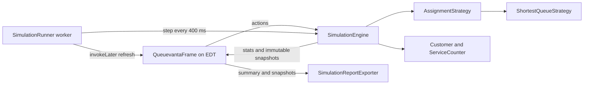

# Architecture

Queuevanta keeps domain state and assignment rules in Java classes, with Swing as a view and input layer. The project has no database, server, network API, or runtime dependency beyond the JDK.

## Responsibilities

- `app/QueuevantaApplication.main` starts the frame on Swing's Event Dispatch Thread (EDT).
- `ui/QueuevantaFrame` builds the dashboard, gathers input, calls engine operations, and renders refreshed data. The frame never selects a counter itself.
- `engine/SimulationEngine` owns counters, customers, completed customers, the tick, statistics, and bounded event history. Its public state operations are synchronized.
- `model/Customer` validates customer lifecycle transitions; `model/ServiceCounter` owns a FIFO waiting queue and one active customer.
- `strategy/AssignmentStrategy` defines routing; `ShortestQueueStrategy` chooses the compatible enabled counter with the smallest active-plus-waiting load, then counter name.
- `model/CounterSnapshot` is immutable display and analytics data. `SimulationEngine.getCounterSnapshots` copies counter values while holding the engine monitor so the EDT does not render mutable counter internals while the worker advances them.
- `service/SimulationStats` summarizes engine state; `CounterValidator` validates new counter names, types, and durations; `SimulationReportExporter` writes a UTF-8 CSV summary.
- `concurrent/SimulationRunner` advances ticks on one scheduled daemon worker and posts view refreshes with `SwingUtilities.invokeLater`.

## Data flow

1. The frame passes a service and count to the engine when the user generates customers.
2. The engine creates customers and delegates counter choice to the assignment strategy.
3. At each unpaused tick, every counter advances independently; newly free counters start the next FIFO customer.
4. The frame requests statistics and immutable snapshots, then updates Swing widgets on the EDT.
5. CSV export reads a statistics record and counter snapshots and writes them via the Java standard library.

## Timing and metrics

The scheduled interval is 400 ms. It is only a pacing mechanism: service and wait are counted in abstract ticks. Average waiting and service durations include completed customers only. Maximum counter load tracks active plus waiting customers after an assignment. A counter's estimated wait is remaining active service plus configured service ticks per waiting customer. The UI warning compares that estimate to a user-selected threshold. No utilization is calculated because no observation-window busy/idle model exists.

## Concurrency and lifecycle

The scheduled executor has one daemon worker. `SimulationEngine` synchronizes methods that access shared state, while `CounterSnapshot` detaches data before presentation. Swing widgets are changed from the EDT: user actions already run there, and worker callbacks use `invokeLater`. Pause cancels the scheduled task; resume does not create a second active task; reset pauses, clears engine state, and requests a refresh. Closing the frame closes the runner and its executor.

Disabling a counter prevents new assignments and prevents its waiting line from starting while disabled. An active customer may finish normally; assigned customers remain on that counter and are not orphaned. Re-enabling lets the waiting queue progress again. Removing a counter with any active or waiting load is rejected.

## Packages and tests

`src/main/java/com/queuevanta` contains the packages above. `SimulationEngineTest` covers engine state, assignment, validation, and snapshots. `SimulationReportExporterTest` covers CSV output and invalid destinations. GUI behavior and scheduled-runner stress/lifecycle remain manual verification gaps; see [Testing](TESTING.md).
